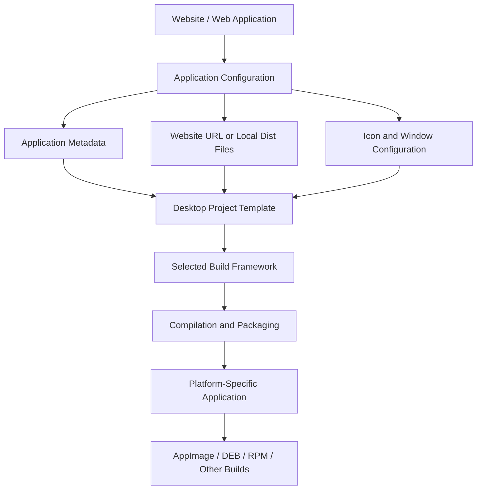
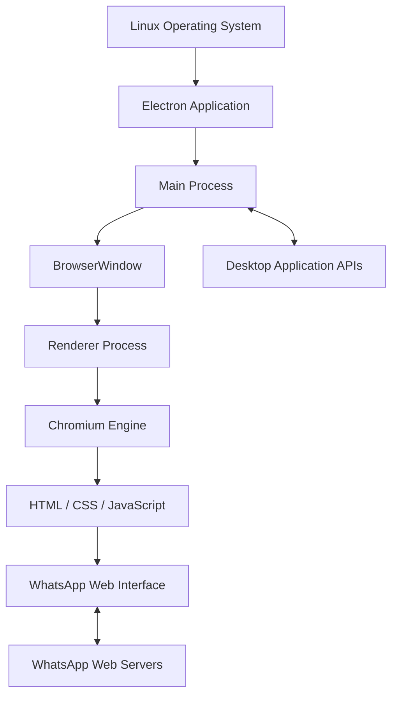
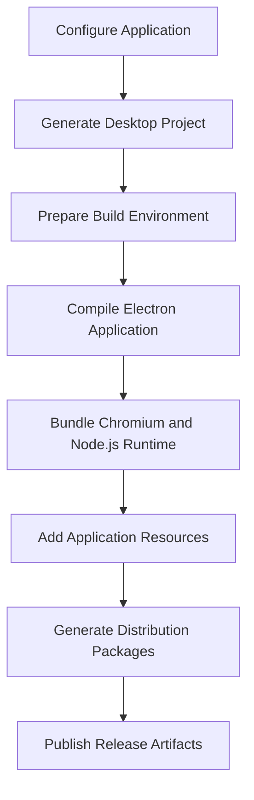
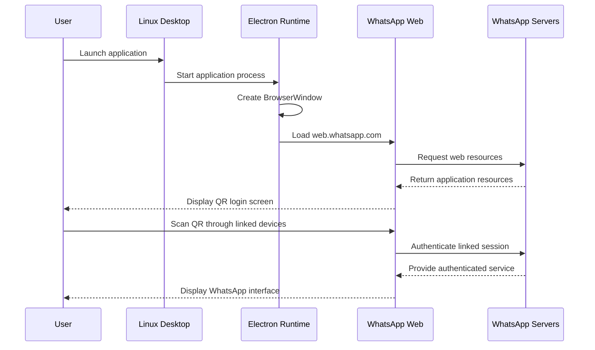

# WhatsApp for Linux

<p align="center">
  
</p>

<h1 align="center">WhatsApp for Linux</h1>

<p align="center">
  A dedicated desktop experience for WhatsApp Web on Linux.
</p>

<p align="center">
  
  
  
  
  
</p>

---

## Overview

**WhatsApp for Linux** is an unofficial desktop application that packages WhatsApp Web into a standalone Electron-based application.

It provides Linux users with a dedicated application window for messaging and communication without needing to keep WhatsApp open in a browser tab.

The application connects to the official WhatsApp Web service and uses WhatsApp's linked-device functionality.

## Features

- Dedicated WhatsApp desktop application.
- Access to WhatsApp Web.
- QR-code-based account linking.
- Messaging and conversation management.
- Photo and document sharing supported by WhatsApp Web.
- Standalone application window.
- Linux x86_64 AppImage distribution.
- Dedicated desktop launcher and application icon.

Feature availability depends on WhatsApp Web.

## Screenshots

Screenshots of the application can be added here.

## Download

Visit the GitHub Releases page to download the latest version.

**[Download WhatsApp for Linux](https://github.com/ashwin20051222/Whatsapp_for_linux/releases)**

### Available package

| Package | Platform | Architecture |
|---|---|---|
| AppImage | Linux | x86_64 |

## Installation

### Arch Linux and other AppImage-compatible distributions

Download the latest `.AppImage` file from Releases.

Make the downloaded file executable:

```bash
chmod +x WhatsApp-Web_0.0.1_amd64.AppImage
```

Launch the application:

```bash
./WhatsApp-Web_0.0.1_amd64.AppImage
```

### Optional application directory

```bash
mkdir -p ~/Applications/WhatsApp

cp WhatsApp-Web_0.0.1_amd64.AppImage \
   ~/Applications/WhatsApp/WhatsApp.AppImage

chmod +x ~/Applications/WhatsApp/WhatsApp.AppImage
```

Launch:

```bash
~/Applications/WhatsApp/WhatsApp.AppImage
```

Replace the example filename with the actual downloaded release filename when necessary.

## Account Setup

1. Launch WhatsApp for Linux.
2. Wait for the WhatsApp Web login screen.
3. Open WhatsApp on your smartphone.
4. Navigate to **Linked Devices**.
5. Select **Link a Device**.
6. Scan the QR code displayed in the desktop application.

Your existing WhatsApp account will be connected through WhatsApp's linked-device functionality.

## System Requirements

| Component | Requirement |
|---|---|
| Operating System | Linux |
| CPU Architecture | x86_64 / AMD64 |
| Application Framework | Electron |
| Distribution Format | AppImage |
| Internet Connection | Required |
| WhatsApp Account | Required |

## Project Information

| Property | Details |
|---|---|
| Project | WhatsApp for Linux |
| Version | 0.0.1 |
| Framework | Electron |
| Target Platform | Linux |
| Architecture | x86_64 |
| Repository | [Whatsapp_for_linux](https://github.com/ashwin20051222/Whatsapp_for_linux) |

## Privacy and Security

This application is a desktop wrapper around WhatsApp Web. It does not implement an independent messaging service or replace WhatsApp's infrastructure.

Authentication, conversations, messaging and linked-device functionality are provided by WhatsApp.

Never share your QR code, authentication session, or personal account information.

## Disclaimer

WhatsApp for Linux is an independent, unofficial community project.

It is not affiliated with, endorsed by, sponsored by, or officially supported by WhatsApp or Meta Platforms, Inc.

WhatsApp and its logo are trademarks of their respective owners.

## License

This repository's licensing terms should be followed when using or redistributing the project. Refer to the repository's LICENSE file where available.

## Links

- **Repository:** https://github.com/ashwin20051222/Whatsapp_for_linux
- **Releases:** https://github.com/ashwin20051222/Whatsapp_for_linux/releases
- **WhatsApp Web:** https://web.whatsapp.com/
- **Issues:** https://github.com/ashwin20051222/Whatsapp_for_linux/issues


---

# Technical Architecture – WhatsApp for Linux

## 1. Web-to-Desktop Application Packaging

A web-to-desktop application packaging tool converts existing websites and web applications into installable desktop or mobile application packages.

It automates application configuration, project generation, compilation and release preparation.

Instead of developing a separate desktop frontend, configuring a desktop runtime, preparing application resources and building platform-specific installers manually, a packaging tool provides an integrated workflow.

It can work with website URLs, standalone HTML files and compiled frontend projects such as Vue and React applications.

The desktop application runs inside a dedicated runtime environment that provides the interface between the web application and the operating system.

## 2. How Does a Website Become a Desktop Application?

A website normally runs inside a web browser. It consists of frontend technologies such as:

- HTML – Defines the document structure.
- CSS – Controls presentation and layout.
- JavaScript – Implements application logic and interactions.
- HTTP/HTTPS – Enables communication between the browser and remote servers.

A desktop wrapper provides an application container around the existing web application.

The website's frontend does not necessarily need to be rewritten. Instead, a desktop runtime creates an application window and loads the configured website URL or local web files.

For this project, the application loads:

`https://web.whatsapp.com/`

The desktop project is configured to open this address through the selected application framework.

### High-Level Packaging Architecture



## 3. Role of Electron in This Project

This WhatsApp application was built using Electron.

[Electron](https://www.electronjs.org/) is an open-source framework for building cross-platform desktop applications using web technologies.

Electron combines two major components:

**Chromium**

Chromium is the browser engine responsible for rendering web content. It processes HTML, CSS and JavaScript and displays the website inside the desktop application window.

**Node.js**

Node.js provides the JavaScript runtime used by the Electron main process. It enables desktop-level application functionality such as window management, application lifecycle handling and communication with operating-system resources through Electron APIs.

Electron separates application execution into two primary processes:

| Process | Responsibility |
|---|---|
| Main Process | Controls application lifecycle, creates windows and manages desktop functionality. |
| Renderer Process | Runs and renders the website inside the Electron window using Chromium. |

The main process creates a `BrowserWindow`. Its `webContents` interface loads the configured website using `loadURL()`.

### Electron Runtime Architecture



This is the conceptual Electron architecture. It describes the runtime model rather than claiming to reproduce every internal implementation detail of the generated application.

## 4. How the Website Is Loaded

For a remote website, Electron can load the web application directly from its URL.

The following is an illustrative Electron implementation:

```javascript
const { app, BrowserWindow } = require('electron');

function createWindow() {
    const mainWindow = new BrowserWindow({
        width: 1280,
        height: 800
    });

    mainWindow.loadURL('https://web.whatsapp.com/');
}

app.whenReady().then(createWindow);
```

The important operation is:

```javascript
mainWindow.loadURL('https://web.whatsapp.com/');
```

This instructs Electron to navigate its application window to the specified HTTPS address.

The Chromium renderer then downloads and executes the website's resources, including its HTML, stylesheets, JavaScript bundles, images and other required assets.

The website continues to communicate with its own backend services over the network.

Consequently, the desktop application provides a dedicated application environment, while the actual WhatsApp Web functionality remains provided by WhatsApp.

## 5. Application Build and Packaging Pipeline

The application packaging workflow simplifies the generation of platform-specific application packages.

The general packaging workflow consists of the following stages.

### Stage 1 – Project Configuration

The developer specifies the application parameters:

| Parameter | WhatsApp Project Configuration |
|---|---|
| Application Name | WhatsApp-Web |
| Website URL | https://web.whatsapp.com/ |
| Application ID | in.ashwin20051222.whatsappweb |
| Version | 0.0.1 |
| Build Framework | Electron |
| Target Platform | Linux x86_64 |
| Application Icon | Custom WhatsApp icon |

These parameters identify the application and control its packaging configuration.

### Stage 2 – Project Generation

An application packaging system uses project templates and the supplied configuration to prepare the project for the selected desktop build framework.

The configuration includes application metadata, website address, platform settings and graphical resources.

### Stage 3 – Compilation

The configured project is compiled using the selected build framework and its platform-specific toolchain.

For this project, Electron provides the Chromium and Node.js runtime required by the packaged application.

The packaging process combines the application files, runtime components, metadata and graphical resources.

### Stage 4 – Application Packaging

The compiled application is prepared in the selected distribution format.

Depending on the build configuration and supported target platforms, application packages can include:

- Linux AppImage
- Debian DEB package
- RPM package
- Windows application packages
- macOS application packages

### Stage 5 – Release Distribution

The completed build artifacts can be published through the project's GitHub Releases page.

Users can download the appropriate package and run or install it on a compatible operating system.

### Build Pipeline



For cloud builds, GitHub Actions can provide the continuous integration environment used to execute the build and release workflow. Local packaging can also be used when supported by the build configuration.

## 6. How WhatsApp for Linux Works at Runtime

After installation, the application operates as a standalone desktop process.

Its runtime sequence is:

1. The Linux desktop launches the WhatsApp application.
2. The Electron main process initializes the application.
3. Electron creates a desktop window.
4. The Chromium renderer loads WhatsApp Web.
5. WhatsApp Web retrieves its frontend resources from WhatsApp's servers.
6. The login interface displays the QR code.
7. The user scans the QR code using WhatsApp's Linked Devices feature.
8. WhatsApp handles account authentication and linked-device communication.
9. Messages and other supported features operate through WhatsApp's web service.

### Runtime Sequence Diagram



## 7. Electron vs. Tauri

Electron and Tauri have different runtime architectures and application packaging approaches.

| Technical Aspect | Electron | Tauri 2 |
|---|---|---|
| Primary implementation | JavaScript and native components | Rust and JavaScript |
| Rendering engine | Bundled Chromium | System WebView |
| Backend runtime | Node.js | Rust |
| Application interface | BrowserWindow | WebView-based window |
| Runtime dependencies | Chromium and Node.js included | Uses platform WebView |
| Package size | Generally larger | Generally smaller |
| Rendering consistency | Chromium-based rendering | Depends on system WebView |
| Best suited for | Consistent Chromium environment and extensive Electron ecosystem | Lightweight desktop applications |

**Why Electron was selected for this project:**

Electron provides a bundled Chromium environment, offering a consistent browser-engine baseline across supported desktop platforms. It also supplies a mature desktop application framework.

The trade-off is a larger application package because the browser runtime and supporting components are distributed with the application.

Tauri can produce smaller packages by using the platform's existing WebView, but its rendering and system integration characteristics differ.

## 8. Technical Architecture of WhatsApp for Linux

WhatsApp for Linux is a desktop wrapper around the official WhatsApp Web service.

It is important to distinguish the application packaging layer from the messaging service itself.

| Component | Responsibility |
|---|---|
| Application Packaging System | Application generation and packaging orchestration |
| Electron | Desktop runtime and application window |
| Chromium | Web content rendering |
| WhatsApp Web | Messaging interface and frontend logic |
| WhatsApp Infrastructure | Authentication, messaging and account services |
| Linux | Operating system and application execution environment |

This application does not independently implement the WhatsApp messaging protocol, replace WhatsApp's backend or convert WhatsApp's proprietary frontend into native Linux code.

The application's functionality depends on WhatsApp Web, network connectivity and WhatsApp's supported linked-device features.

## 9. Technical References

- **Electron Official Documentation:** https://www.electronjs.org/docs/latest/
- **Electron Process Model:** https://www.electronjs.org/docs/latest/tutorial/process-model
- **Electron BrowserWindow API:** https://www.electronjs.org/docs/latest/api/browser-window
- **WhatsApp Web:** https://web.whatsapp.com/
- **GitHub Actions Documentation:** https://docs.github.com/en/actions

---

**Summary:** The application packaging workflow generates and builds the desktop project. Electron supplies the desktop runtime, Chromium renders WhatsApp Web, and WhatsApp's own infrastructure provides the messaging service. The result is a Linux desktop application that gives WhatsApp Web a dedicated application window without independently reimplementing WhatsApp.
